# DayDayOn 五层软件工程架构解析与演进决策台账（活文档）

> 日期：2026-11-10 · 状态：**核心决策已落地闭环（全天三餐统一评分、人群差异化走廊与两阶段庆祝状态机）**
> 配套交互画布：[system-architecture-canvas.html](./system-architecture-canvas.html)（数据源：[canvas-data.js](./arch-canvas/canvas-data.js)）
> 关联总纲 Issue：[#59 `fix(checkin): 打卡与 Agent 全链路状态贯通、饮食全天周期裁判与架构收敛总纲`](https://github.com/AIMFllyYS/DayDayOn/issues/59)

---

## 0. 文档定位与最高工程原则

本文档与交互式架构画布 [system-architecture-canvas.html](./system-architecture-canvas.html) 互为镜像，遵循以下最高工程原则：

1. **最简代码、最高复用、零重复造轮子**：全面复用现有 `CheckinFlow`、`FillSection`、`listCheckins`、`updateCheckin`、`streamReferee` 与 PostgreSQL `checkins` 表，不新增多余的前端子面板或冗余状态表。
2. **唯一真实数据源（Single Source of Truth）**：所有打卡状态（含常规打卡、分餐打卡、智能拍照/上传、Agent 对话改数据、跳过本次打卡）一律收敛至 PostgreSQL `checkins` 表；前端重进打卡页或切换餐次 Tab 时直接读取数据库记录回填。
3. **凌晨 00:00 统一刷新**：每日打卡数据固定在用户本地时区**凌晨 00:00** 刷新（`DEFAULT_DAY_START_HOUR = 0`），不由用户自定义刷新时间。

---

## 1. 基于最新交互画布的五层架构全景拆解（L1–L5）

画布将 DayDayOn 全栈架构划分为 **5 个工程层（Zones）**，共收录 **71 个核心节点**（36 个业务/逻辑节点 + 35 张数据库表）：

```mermaid
flowchart TD
    subgraph L1["L1 前端交互与容器层 (12 节点)"]
        AppShell["ui-app-shell<br/>AppShell 与应用外壳"]
        CheckinFlow["ui-checkin-flow [BROKEN]<br/>打卡页骨架 CheckinFlowPage"]
        ModDiet["mod-diet [WARNING]<br/>饮食打卡板块 (好好吃饭)"]
        ModOthers["ui-mod-exercise / sleep / study / custom<br/>其余四大打卡板块"]
        AgentHost["ui-agent-host<br/>AgentHost 与对话抽屉"]
        MascotHost["ui-mascot-host<br/>萌宠交互主机"]
        ImgComp["ui-image-compressor<br/>内存图片压缩器 (零落盘)"]
        SmartOrphan["ui-smart-orphan [BROKEN]<br/>快捷拍照孤岛 /checkin/smart"]
        Playbook["ui-playbook<br/>/dev/playbook 组件沙盒"]
    end

    subgraph L2["L2 前后端共用纯领域层 (9 节点)"]
        Dispatcher["domain-rules-dispatcher<br/>裁判统一分发器 judge()"]
        RefDiet["domain-referee-diet [WARNING]<br/>饮食纯裁判规则 judgeDiet"]
        RefOthers["domain-rules-exercise / sleep / study / custom<br/>其余四大板块纯规则"]
        Registry["domain-checkin-registry<br/>打卡板块注册表 CHECKIN_MODULES"]
        Clock["domain-clock-engine<br/>00:00 日切时钟引擎"]
        Stats["domain-stats-engine<br/>纯统计与连胜引擎 (仅认 isValid)"]
    end

    subgraph L3["L3 AI 智能体编排层 (6 节点)"]
        RunAi["ai-gateway-run<br/>AI 统一执行网关 runAi"]
        StreamRef["ai-streaming-referee [WARNING]<br/>流式裁判团团 streamReferee (6步)"]
        AgentChat["ai-agent-chat<br/>对话团团 AgentChat (20步)"]
        RefTools["ai-referee-tools<br/>裁判事实工具集 RefereeTools"]
        DeepSeek["ai-deepseek-provider<br/>deepseek-flash 唯一模型实例"]
        QuotaLedger["ai-quota-ledger<br/>额度账本与微元定价中心"]
    end

    subgraph L4["L4 服务端业务服务与收口层 (9 节点)"]
        HonoGw["api-hono-gateway<br/>Hono /api/v1 路由网关"]
        SvcCreate["svc-checkin-create<br/>打卡创建与全天结算服务"]
        SvcMutate["svc-checkin-mutate<br/>打卡变更与留痕服务"]
        SvcDietRec["svc-diet-recognition<br/>纯内存图像识别服务"]
        SvcSocial["svc-auth / mail / pet / notifications / rank<br/>认证、邮件与社交服务群"]
    end

    subgraph L5["L5 数据持久层 PostgreSQL 18 & Drizzle (35 张表)"]
        TblCheckins["tbl-checkins / tbl-checkin-revisions<br/>打卡主表与不可篡改留痕表"]
        TblGoals["tbl-goals / tbl-profiles / tbl-body-metrics<br/>目标、个人档位与每日体重"]
        TblAgent["tbl-agent-conversations / tbl-agent-messages<br/>Agent 会话与多轮消息"]
        TblQuota["tbl-quota-accounts / tbl-quota-ledger / tbl-ai-runs<br/>额度账户、流水与 AI 审计"]
    end

    CheckinFlow --> ModDiet
    CheckinFlow --> Dispatcher
    ModDiet --> RefDiet
    CheckinFlow --> HonoGw
    AgentHost --> HonoGw
    SmartOrphan -. "e-bug-smart-orphan (待并入统一状态机)" .-> SvcCreate
    ModDiet -. "e-bug-diet-cycle (全天周期+硬覆盖)" .-> CheckinFlow
    AgentChat -. "e-bug-chat-sync (追问修改回写DB)" .-> CheckinFlow
    TblCheckins -. "e-bug-reenter (按今日记录读取回填)" .-> CheckinFlow
    HonoGw --> SvcCreate
    HonoGw --> StreamRef
    HonoGw --> AgentChat
    SvcCreate --> Dispatcher
    SvcCreate --> TblCheckins
```



---

## 2. 核心 Bug 根因诊断与 4 条断链解剖

### 2.1 严重 Bug 专项诊断：「早餐打完后无法打午餐；打完午餐后显示的还是早餐」

通过追踪 [checkin-flow.tsx](../../src/features/checkin/flow/checkin-flow.tsx#L100-L225) 与 [diet/form.tsx](../../src/features/checkin/modules/diet/form.tsx#L124-L136)，定位出 3 个叠加在一起的代码级根因：

1. **状态未按餐次（`mealType`）隔离**：
   - 在 `CheckinFlow` 中，`subject`（第 100 行）和 `saved`（第 102 行 `useState<Checkin | null>(null)`）是整个页面的单一变量，不感知当前选中的是 `breakfast` 还是 `lunch`。
2. **切换餐次 Tab 时未重置或切换 `saved`（导致“无法打午餐”）**：
   - 当用户打完早餐并在结果弹窗点击「完成」（第 505 行 `setPopup(false)`）留在打卡页后，`saved` 依然保存着**早餐的 `Checkin` 对象**。
   - 用户点击 `SegmentedControl` 切换到「午餐」时，`useDietForm` 只更新了内部的 `meal = 'lunch'`，**既没有通知 `CheckinFlow`，而 `CheckinFlow` 的 `invalidateAnalysis()`（第 168 行）也从未调用 `setSaved(null)`**。
   - 结果：底部操作栏（第 370–378 行）命中 `saved ? <Button>查看分析</Button> : ...` 分支，提交按钮被永久锁死为早餐的「查看分析」，导致**无法提交午餐**！
3. **`saved?.verdict` 优先级锁死（导致“打完午餐显示的还是早餐”）**：
   - 就算用户通过切换顶部模式（手动/拍照）强行触发了午餐的分析，第 130 行计算结论时写的是：
     ```ts
     const verdict = saved?.verdict ?? referee.verdict ?? offlineVerdict
     ```
   - 因为 `saved` 从未被清空，`saved?.verdict`（早餐的结论）永远短路排在第一位，把午餐刚跑出来的 `referee.verdict` 徹底盖住，导致页面上显示的永远还是早餐！

---

## 3. 已拍板的核心业务与架构决策台账（D1–D6）

> **状态图例**：`✅ 已拍板`

### 3.1 决策域 D1：重进打卡页读取回填、餐次切换与凌晨 0 点刷新（`e-bug-reenter`）

- **当前状态**：`✅ 已拍板`
- **拍板结论**：
  1. **固定凌晨 00:00 刷新**：将 [`src/lib/time/zone.ts`](../../src/lib/time/zone.ts#L25) 的 `DEFAULT_DAY_START_HOUR` 及默认日切统一调整为 `0`（凌晨 0 点刷新，不让用户自定义刷新时刻）。
  2. **极简数据库读取回填（前端不加花哨标记）**：
     - 进入打卡页时，直接读取数据库今日已打卡记录（`GET /api/v1/goals/{goalId}/checkins?from=today&to=today`）。
     - **不在** `早餐 / 午餐 / 晚餐 / 加餐` 切换栏上增加任何“已打标记”或额外子面板，保持现有极简 UI。
     - 在凌晨 0 点刷新前，点进「早餐」Tab，直接从数据库记录读取并展示今天早餐打卡完毕后的所有状态（菜品、备注、Agent 分析结论与报告）；切到尚未打卡的「午餐」Tab，自动切换为空白待打卡状态，彻底修复“早餐打完无法打午餐、显示串台”的 Bug。

### 3.2 决策域 D2：饮食以「天」为单位结算、加餐「硬覆盖」且无回退机制（`e-bug-diet-cycle`）

- **当前状态**：`✅ 已拍板`
- **拍板结论**：
  1. **三餐齐备结算当日总分**：
     - 饮食打卡以**天**为单位。不管每顿吃得怎样都记录在内；当今天的**早餐、午餐、晚餐**全部打卡完毕后，汇总计算出今日总分。
     - 根据今日总分对比 `passScore`（默认 `3.0` 分）：达标则今日饮食打卡成功（`isValid = true`），计入当日进度与连击。
  2. **加餐（或重打）直接「硬覆盖」（Hard Overwrite），不做软覆盖、不做回退机制**：
     - 如果三餐打完后用户又打了「加餐」（`snack`），系统立即将加餐纳入全天总分重新计算，并**用重新计算后的结果直接硬覆盖当日的打卡数据与有效状态（`isValid`）**。
     - **允许状态翻转**：哪怕三餐打完时已经算成功打卡（`isValid = true`），如果加餐吃了不健康食物导致全天分数掉到及格线以下，直接硬覆盖为打卡失败（`isValid = false`）。
     - **工程极简化**：不需要保留覆盖前的历史有效态、不需要设计“软覆盖”或“防降级回退机制”，由此大幅简化服务端与前端判据。

### 3.3 决策域 D3：饮食评分规则调优（空腹加分、高钠轻扣、纤维奖励、优质油脂搜索、肥胖夜间碳水扣分）

- **当前状态**：`✅ 已拍板`
- **拍板结论**：
  1. **空腹（`空腹`）不扣分且适当加分 + 标签首位预设 + 备注第一优先级**：
     - **饮食标签首位预设**：在饮食手动打卡的默认常用标签（`DEFAULT_FAVS`）中，将 **`"空腹"`** 排在第一个位置；属性与其他标签完全一致，用户可长按更改或删除。
     - **备注第一核心优先级**：用户在「备注」行填写“空腹”时，无论前面菜品或照片是什么，Agent 与规则均以备注为第一核心优先级，默认上下文即为“空腹”。
     - **加分免扣规则**：即使因空腹导致单餐或当日膳食纤维未达标，**空腹绝不扣分，反而适当加分（`+1.0 ~ +1.5` 分）**，特别是对偏胖/减脂人群（`strict-fat-loss`）有助于控制热量缺口。无需考虑“一直空腹”的极端边界条件。
  2. **高钠饮食（`钠`）大幅降低扣分力度**：
     - 中国食堂/外卖餐饮钠普遍超标且无法避免。钠超标仅做极轻微扣分（如仅扣 `0.1` 分），绝不因高钠把正常餐食判为低分。
  3. **膳食纤维（`膳食纤维`）适度多加分**：
     - 摄入充足蔬菜/膳食纤维时给予略高加分奖励（如 `+0.6 ~ +0.8` 分），单餐缺纤维不重罚。
  4. **脂肪类（如坚果）结合 Agent 搜索动态评判**：
     - 引导 Agent 多次结合内置营养表与 `webSearch` 搜索核实食材油脂属性：像**坚果**等高质量油脂，只要摄入量适中（不多），给予相对加分（`+0.2 ~ +0.4` 分）；仅在摄入量过大或劣质反式/油炸脂肪时扣分。
  5. **肥胖人群（`strict-fat-loss`）夜间低质量精制碳水扣分**：
     - 仅针对肥胖/减脂严管人群，晚餐或夜间摄入**大米饭、精米白面**等低质量高 GI 碳水时扣分（避免夜间胰岛素波动与脂质/胆固醇合成倾向）；但夜间摄入**土豆、玉米、红薯**等高质量复合碳水不扣分。
  6. **整体扣分温和化**：
     - 正常吃一顿普通饭菜必须能拿到合理高分并顺利打卡，杜绝“正常吃饭却被判极低分打不了卡”的情况。

### 3.4 决策域 D4：拍照/智能上传强制复用「备注」并作为高优先级上下文喂给 Agent

- **当前状态**：`✅ 已拍板`
- **拍板结论**：
  1. **前端直接复用 `备注` 分区组件**：
     - 在「智能拍照」（`smart-capture`）和「智能上传」（`smart-upload`）模式下，页面始终展示并复用现有的「备注」（`note`）`FillSection` 组件，允许用户在拍照前或识别后填写备注。
  2. **备注与图片/识别内容共同作为 Agent 上下文（备注具有修正优先权）**：
     - 将用户填写的 `note` 一并传给识图接口（`/api/v1/ai/smart-recognitions`）与裁判接口（`/api/v1/goals/{goalId}/referee`）。
     - 例如：晚上拍的食堂照片里有米饭和菜，但用户备注写“我晚上没吃饭（只吃了菜）”，Agent 必须采信备注上下文，将米饭剔除或计为 `0g`，不计入碳水与高 GI 扣分。

### 3.5 决策域 D5：全板块底部新增「跳过本次打卡」折叠组件（仅手动模式）

- **当前状态**：`✅ 已拍板`
- **拍板结论**：
  1. **位置与样式**：在打卡页面最底部（往下滑最后一项），为**所有 5 个打卡板块**统一挂载一个「跳过本次打卡」折叠组件，完全复用现有 `FillSection` 样式（与「备注」样式一致）。
  2. **触发条件**：**仅在「手动填写」（`manual`）模式下显示并可用**；在「智能拍照」和「智能上传」模式下隐藏。
  3. **操作与免填规则**：用户展开「跳过本次打卡」后必须填写跳过理由；只要填了跳过理由，页面上的其他表单项可以完全不填或任意填写。
  4. **Agent 理由核验通过后直接自动入库并弹盖章窗**：
     - 提交后由 Agent 分析跳过理由是否合理充分；
     - 只要 Agent 判定理由通过，**无需用户在抽屉二次点确认，直接自动写入数据库并豁免通过（`isValid = true`），立即弹出与正常打卡成功 100% 一致的「打卡成功，连击 +1」盖章弹窗**。

### 3.6 决策域 D6：团团多轮对话改数据与快捷智能打卡统一状态机（`e-bug-chat-sync` & `e-bug-smart-orphan`）

- **当前状态**：`✅ 已拍板`
- **拍板结论**：
  1. **唯一打卡状态机**：无论是打卡页内「接着问团团」改数据、在任意页面打开团团更新今日数据、还是从主页点「智能拍照 / 智能上传」，底层工具与入库通道完全打通，统一读写 PostgreSQL `checkins` 表。
  2. **跨入口无缝回显**：在智能打卡或 Agent 对话中完成打卡/修改后，回到目标打卡页时直接通过数据库读取（D1）展示最新打卡状态。

---

## 4. 主 Issue 与 Sub-issues 父子依赖规划表

| 规划槽位 | 对应决策域 | 拟定范围 | 涉及画布层与核心节点 | 前置依赖 | GitHub Issue 编号 |
|---|---|---|---|---|---|
| **Parent** | 全域总纲 | 打卡与 Agent 全链路状态贯通、饮食全天周期裁判与架构收敛总纲 | L1–L5 全景 | — | **#59**（已创建） |
| **Sub-1** | **D2 + D3** 饮食全天计分与温和规则 | 饮食全天周期计分（三餐结算+加餐硬覆盖）、空腹加分、高钠轻扣、纤维奖励、坚果搜索与肥胖夜间精碳扣分 | L2 `domain-referee-diet`、L3 `ai-referee-tools`、L4 `svc-checkin-create` | 无（纯函数与服务层先行） | *待实施确认* |
| **Sub-2** | **D1 + D4 + D5** 打卡页闭环与跳过打卡 | 凌晨 0 点刷新、重进打卡页按餐次读库回填、修复早→午餐串台 Bug、拍照/上传复用备注上下文、手动模式底部「跳过本次打卡」 | L1 `ui-checkin-flow` / `mod-diet`、L3 `ai-streaming-referee` | 依赖 **Sub-1** | *待实施确认* |
| **Sub-3** | **D6** 对话改数据与智能打卡统一状态机 | 团团多轮对话调改回写、全局 Agent 工具互通、主页快捷拍照/上传直接写库并在打卡页回显 | L1 `ui-agent-host` / `ui-smart-orphan`、L3 `ai-agent-chat` | 依赖 **Sub-2** | *待实施确认* |

---

## 5. 决策变更记录（Changelog）

| 日期 | 变更摘要 | 关联 Issue |
|---|---|---|
| 2026-11-07 | 基于最新五层架构画布（L1–L5、71 节点、35 表、4 条断链、S1–S5 场景）初始化架构解析与决策台账，关联总纲 Issue #59 | #59 |
| 2026-11-08 | 拍板锁定 D1–D6 六大核心决策：凌晨 0 点刷新与极简读库回填、早→午餐串台 Bug 根因定位、饮食全天结算与加餐硬覆盖（无回退）、空腹加分与温和扣分规则、拍照复用备注高优上下文、手动模式底部「跳过本次打卡」组件及全局唯一状态机 | #59 |
| 2026-11-10 | 根治「假全天、真单餐」断层：确立 `Verdict.settlement`（`pending` 1/3·2/3 不打单餐分不弹窗 → `settled` 3/3 统一算全天总分并弹庆祝成绩单）；底分升至 `3.8` 消除隐形扣分；减脂档低卡（如 100 kcal）加分不扣分、增肌档低卡扣分；膳食纤维纯加分零扣分；`create/update/delete` 全路径重算闭环，Playbook 与 `docs.ts` 同源化 | #59 |
